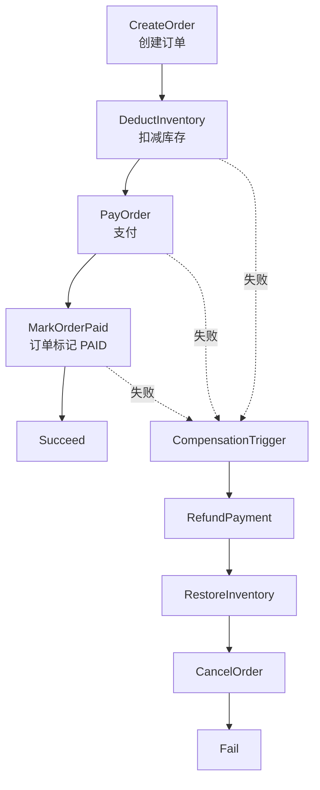

# Seata Saga Demo（Spring Boot 4.0.7 + Seata 2.6.0）

这是一个用于学习 Seata Saga 状态机模式的可运行示例项目。场景是电商下单：**创建订单 → 扣减库存 → 支付 → 将订单改为已支付**。任一正向节点失败时，状态机根据已经成功的节点逆序调用补偿动作。

项目把三个业务模块拆成三个独立 Spring Boot 服务，使用三个独立 MySQL Schema；状态机由 `order-service` 发起和编排。

## 1. 技术栈

| 组件 | 版本/实现 |
|---|---|
| JDK | 21 |
| Spring Boot | 4.0.7 |
| Seata Client / Server | 2.6.0 |
| Seata Server 容器 | `apache/seata-server:2.6.0.jdk21` |
| MySQL | 8.4 |
| 构建 | Maven 多模块 |
| 服务间调用 | Spring `RestClient` |
| 本地事务 | Spring JDBC `@Transactional` |

> Seata 2.6.0 的服务端下载页面标注 JDK 25+ 为最低要求；Apache Docker Hub 同时提供明确标记的 `2.6.0.jdk21` 镜像。本示例在 Compose 中使用该 JDK 21 镜像，便于 JDK 21 的开发环境学习。生产部署请遵循你选用的 Seata Server 发行包/镜像的 JDK 要求。

## 2. 项目结构

```text
seata-saga-springboot407-demo
├── pom.xml                         # 父 POM / Maven 聚合
├── docker-compose.yml              # MySQL + Seata Server
├── scripts
│   └── mysql-init.sql              # 三个业务库、Saga 三张状态机表、演示库存
├── saga-api                        # 服务间共享 DTO
├── order-service                   # Saga 发起方 + 订单业务
│   └── src/main/resources/statelang/place_order_saga.json
├── inventory-service               # 库存参与者：扣减 / 恢复
└── payment-service                 # 支付参与者：支付 / 退款
```

| 服务 | 端口 | 数据库 | 职责 |
|---|---:|---|---|
| order-service | 8081 | `order_db` | 启动状态机、保存订单、取消订单、标记支付成功 |
| inventory-service | 8082 | `inventory_db` | 扣库存、恢复库存 |
| payment-service | 8083 | `payment_db` | 支付、退款 |
| Seata Server | 8091 / 7091 | file store | 全局事务协调；7091 为控制台端口 |
| MySQL | 3306 | 三个 Schema | 业务数据 + Saga 状态机日志 |

## 3. Saga 模式原理

Saga 不是把三个服务包进一个跨库数据库事务，也不是依靠 undo log 自动恢复。它把一条长事务拆成多个**各自提交的本地事务**：

1. 正向动作执行成功后，本地事务立即提交。
2. 状态机记录每个节点的运行状态和输入/输出上下文。
3. 后续节点失败时，状态机按成功节点的逆序触发补偿节点。
4. 每个补偿节点由业务开发实现，例如 `pay → refund`、`deduct → restore`、`createOrder → cancelOrder`。



例如：支付已经成功，但最后更新订单为 `PAID` 失败时，状态机不会“回滚 MySQL 事务”，而是依次调用：

```text
RefundPayment  ->  RestoreInventory  ->  CancelOrder
```

这就是 Saga 的核心：**正向动作 + 对应补偿动作 + 状态机驱动**。Saga 的优势是长流程和跨服务编排更灵活；它不提供传统数据库事务的隔离性，补偿期间可能存在短暂中间状态，业务需自行设计并发控制、幂等和一致性策略。

## 4. 状态机 JSON 怎么读

文件：

`order-service/src/main/resources/statelang/place_order_saga.json`

最重要的几个字段：

| 字段 | 含义 |
|---|---|
| `Name` | 状态机名称；Java 中以 `placeOrderSaga` 启动 |
| `StartState` | 正向流程起点 |
| `Type: ServiceTask` | 调用某个 Spring Bean 方法 |
| `ServiceName` | Spring Bean 名称，例如 `inventoryAction` |
| `ServiceMethod` | Bean 中的方法名，例如 `deduct` |
| `Input` | 从 Saga 上下文取参数，`$.[orderNo]` 对应启动参数的 `orderNo` |
| `CompensateState` | 正向节点对应的补偿节点 |
| `Catch` | 捕获节点异常并路由到 `CompensationTrigger` |
| `CompensationTrigger` | 显式触发逆序补偿 |
| `Succeed` / `Fail` | 状态机正常/异常结束 |

示例片段：

```json
"DeductInventory": {
  "Type": "ServiceTask",
  "ServiceName": "inventoryAction",
  "ServiceMethod": "deduct",
  "CompensateState": "RestoreInventory",
  "Input": ["$.[orderNo]", "$.[productId]", "$.[quantity]", "$.[failAt]"],
  "Catch": [{
    "Exceptions": ["java.lang.Throwable"],
    "Next": "CompensationTrigger"
  }],
  "Next": "PayOrder"
}
```

其中 `inventoryAction` 是 `InventorySagaAction` 上 `@Component("inventoryAction")` 指定的 Bean 名；`deduct` 是正向调用方法；`restore` 是补偿方法。库存服务本身并不知道 Saga 状态机，它只提供可独立调用的本地业务 API。

## 5. 如何运行

### 5.1 环境准备

- JDK 21
- Maven 3.9+
- Docker Engine + Docker Compose
- 本机 3306、7091、8091、8081、8082、8083 端口可用

### 5.2 启动中间件

在项目根目录执行：

```bash
docker compose up -d mysql seata-server
```

查看容器：

```bash
docker compose ps
docker compose logs -f mysql seata-server
```

MySQL 首次初始化会自动执行 `scripts/mysql-init.sql`，创建：

- `order_db`：订单表 + Saga 状态机日志表
- `inventory_db`：库存表 + 库存操作幂等流水
- `payment_db`：支付/退款幂等流水

默认演示库存：`SKU-1001` 可用库存 100。

### 5.3 编译项目

```bash
mvn clean install -DskipTests
```

该命令会先构建并安装共享 DTO 模块 `saga-api`，之后才能在单独终端中用 `spring-boot:run` 启动各服务。若只想构建某一个服务及其依赖，也可以执行：

```bash
mvn -pl inventory-service -am clean install -DskipTests
```

### 5.4 启动三个微服务

打开三个终端，在项目根目录分别执行：

```bash
mvn -pl inventory-service spring-boot:run
```

```bash
mvn -pl payment-service spring-boot:run
```

```bash
mvn -pl order-service spring-boot:run
```

也可以先执行 Maven package，再分别运行各模块 `target` 下的可执行 jar。订单服务启动时会由 Seata Starter 加载 `statelang/*.json` 状态机定义，并注册到 `order_db` 的 `seata_state_machine_def` 表。

### 5.5 检查健康状态

```bash
curl http://127.0.0.1:8081/actuator/health
curl http://127.0.0.1:8082/actuator/health
curl http://127.0.0.1:8083/actuator/health
```

## 6. 演示场景

金额单位是“分”，默认产品是 `SKU-1001`。`orderNo` 必须每次使用新的值，因为它也是 Saga 实例的 `businessKey`，在 Saga 日志表中唯一。

### 场景 A：正常下单成功

```bash
curl -X POST http://127.0.0.1:8081/api/orders/checkout \
  -H 'Content-Type: application/json' \
  -d '{
    "orderNo":"SAGA-20261109-001",
    "productId":"SKU-1001",
    "quantity":2,
    "amountCents":19900,
    "failAt":"NONE"
  }'
```

预期业务状态：订单 `PAID`，库存从 100 变为 98，支付流水 `PAID`，Saga 状态 `SU`。

### 场景 B：扣库存时失败

```json
{
  "orderNo":"SAGA-20261109-002",
  "productId":"SKU-1001",
  "quantity":2,
  "amountCents":19900,
  "failAt":"INVENTORY"
}
```

预期：库存服务在本地事务提交前抛错；状态机取消前面已经创建的订单；库存不会减少。

### 场景 C：支付时失败

```json
{
  "orderNo":"SAGA-20261109-003",
  "productId":"SKU-1001",
  "quantity":2,
  "amountCents":19900,
  "failAt":"PAYMENT"
}
```

预期：订单创建和扣库存已经提交；支付步骤失败；状态机补偿已成功节点：恢复库存 → 取消订单。支付流水不会留下成功扣款。

### 场景 D：支付成功，但订单更新失败（最适合观察完整逆序补偿）

```json
{
  "orderNo":"SAGA-20261109-004",
  "productId":"SKU-1001",
  "quantity":2,
  "amountCents":19900,
  "failAt":"ORDER_UPDATE"
}
```

预期：订单创建、库存扣减、支付都已提交；最后更新订单为 `PAID` 时故意抛错；状态机依次执行 `RefundPayment → RestoreInventory → CancelOrder`。最终订单 `CANCELLED`、库存恢复、支付流水 `REFUNDED`。

`failAt` 只用于学习和演示，允许值：`NONE`、`INVENTORY`、`PAYMENT`、`ORDER_UPDATE`。

也可以使用 IntelliJ IDEA HTTP Client 打开 `scripts/demo-requests.http`，依次执行 4 个场景，再查询订单、库存和支付流水。

> 上述 JSON 可以直接作为 `/api/orders/checkout` 的 POST 请求体。为了节省篇幅，这里将失败演示请求体单独展示。

## 7. 查询业务结果

```bash
# 订单
curl http://127.0.0.1:8081/api/orders/SAGA-20261109-001

# 库存
curl http://127.0.0.1:8082/api/inventory/SKU-1001

# 支付
curl http://127.0.0.1:8083/api/payments/SAGA-20261109-001
```

## 8. 查看 Saga 状态机日志

状态机定义、实例和节点执行日志均保存在发起方 `order_db` 中：

```sql
USE order_db;

-- 已注册的状态机定义
SELECT name, tenant_id, ver, status, gmt_create
FROM seata_state_machine_def;

-- 状态机实例结果（SU = 成功；FA = 失败；UN = 未知）
SELECT id, business_key, status, compensation_status,
       gmt_started, gmt_end
FROM seata_state_machine_inst
ORDER BY gmt_started DESC;

-- 单个订单各节点的正向/补偿执行轨迹
SELECT business_key, name, type, service_name, service_method,
       status, gmt_started, gmt_end
FROM seata_state_inst
WHERE business_key = 'SAGA-20261109-004'
ORDER BY gmt_started;
```

> Saga 执行失败后，请同时看 `status` 和 `compensation_status`。正向失败不等于补偿一定完成；如果补偿服务本身失败，需要关注补偿状态并进行重试/人工处理。

## 9. 业务补偿代码重点

| 正向动作 | 补偿动作 | 实现位置 |
|---|---|---|
| `createOrder` | `cancelOrder` | `order-service/.../OrderSagaAction.java` |
| `deduct` | `restore` | `inventory-service/.../InventoryService.java` |
| `pay` | `refund` | `payment-service/.../PaymentService.java` |

代码刻意展示 Saga 业务实现中容易遗漏的三件事：

1. **幂等**：同一个 `orderNo` 重复调用正向/补偿请求时，不会重复扣库存或重复退款。
2. **空补偿**：补偿请求先到、正向请求没有落库时，补偿接口也能安全返回，并记录墓碑状态。
3. **防悬挂**：空补偿后如果迟到的正向请求才到达，会读取墓碑状态并拒绝继续执行。

这三个动作不能仅靠 JSON 配置代替，必须在参与者的业务代码和数据库约束中实现。

## 10. 常见问题与调整点

### 10.1 为什么只有订单服务配置 Saga 状态机？

因为本示例由订单服务编排整条 Saga。库存、支付是远程参与者，只要提供正向与补偿 API。Saga 状态机定义和执行日志由发起方持久化，便于恢复和排查。

### 10.2 为什么不在 `checkout()` 上添加 `@GlobalTransactional`？

状态机引擎 API `startWithBusinessKey(...)` 本身负责启动/执行 Saga 状态机。这里不叠加 AT 模式的 `@GlobalTransactional`，避免将两个事务模型混在一起。

### 10.3 为什么 Saga 不能保证隔离性？

因为每个参与者的本地事务会提前提交；后续步骤执行期间，其他请求可能看到中间状态。生产上需要配合订单状态机、业务状态校验、库存预占/配额、版本号、业务锁、消息驱动等措施设计并发一致性。

### 10.4 为什么补偿接口需要幂等？

网络超时、进程重启和事务恢复会导致重试。补偿逻辑可能被再次调用，必须确保多次调用的最终效果与调用一次相同。

### 10.5 更换数据库账号或端口

调整三个服务 `application.yml` 的环境变量默认值，或通过环境变量传入：

- `DB_USERNAME` / `DB_PASSWORD`
- `ORDER_DB_URL`
- `INVENTORY_DB_URL`
- `PAYMENT_DB_URL`
- `SEATA_SERVER`
- `INVENTORY_SERVICE_URL` / `PAYMENT_SERVICE_URL`

### 10.6 MySQL 初始化脚本没有重新执行

Docker MySQL 只会在数据卷首次创建时自动执行 `docker-entrypoint-initdb.d`。如需清空本地演示数据并重新建库：

```bash
docker compose down -v
# 注意：该命令会删除本项目的 MySQL / Seata Docker 数据卷。
docker compose up -d mysql seata-server
```

## 11. 日志关键字

日志按模块和动作加了前缀，建议按 `orderNo` 搜索：

- `[SAGA][START]` / `[SAGA][END]`：状态机启动和结束
- `[ORDER][FORWARD]` / `[ORDER][COMPENSATE]`：订单正向、补偿
- `[INVENTORY][FORWARD]` / `[INVENTORY][COMPENSATE]`：库存扣减、恢复
- `[PAYMENT][FORWARD]` / `[PAYMENT][COMPENSATE]`：支付、退款
- `[SAGA-ACTION]`：订单服务调用远程参与者的动作

## 12. 说明

这是教学 Demo，重点是 Saga 状态机编排和补偿原理。需要特别注意：远程调用存在“参与者已提交本地事务，但响应在网络中丢失”的不确定结果窗口；生产系统应为正向/补偿动作提供按业务键查询结果的接口，并结合重试、对账和人工处理机制，不能仅依赖一次 HTTP 调用的返回值判断远端是否提交。生产落地还需要补充认证鉴权、服务注册发现、超时与重试策略、熔断隔离、告警、分布式链路追踪、补偿失败人工处理流程、Saga 实例清理归档以及压测。
